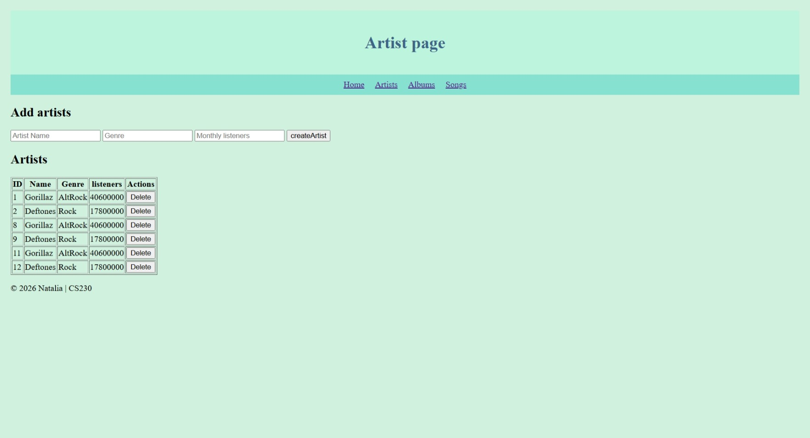
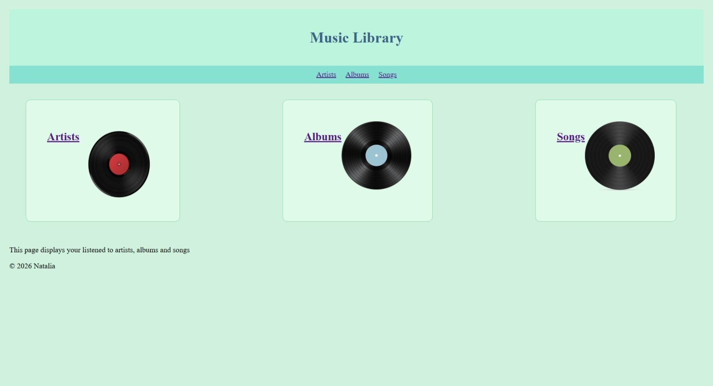

# 🎵 Full-Stack Music Library Application

A  full-stack web application designed to manage, organize, and store music information including artists, albums, and songs. Built as part of a software engineering project to demonstrate full-stack integration, RESTful API design, and database management.
##  App Preview

  
   

##  Features

- **Music Management:** Perform full CRUD (Create, Read, Update, Delete) operations on artists, albums, and tracks.
- **RESTful API Architecture:** Cleanly separated backend endpoints handling HTTP requests and JSON data responses.
- **Relational Database:** Persistent data storage powered by SQLite, managing relationships between artists and their respective music records.
- **Dynamic Frontend Integration:** Asynchronous communication with the backend using the JavaScript Fetch API.

---

##  Tech Stack

- **Frontend:** HTML5, CSS3, Vanilla JavaScript (Fetch API)
- **Backend:** Node.js, Express.js
- **Database:** SQLite
- **Tools & Version Control:** Git, VS Code,